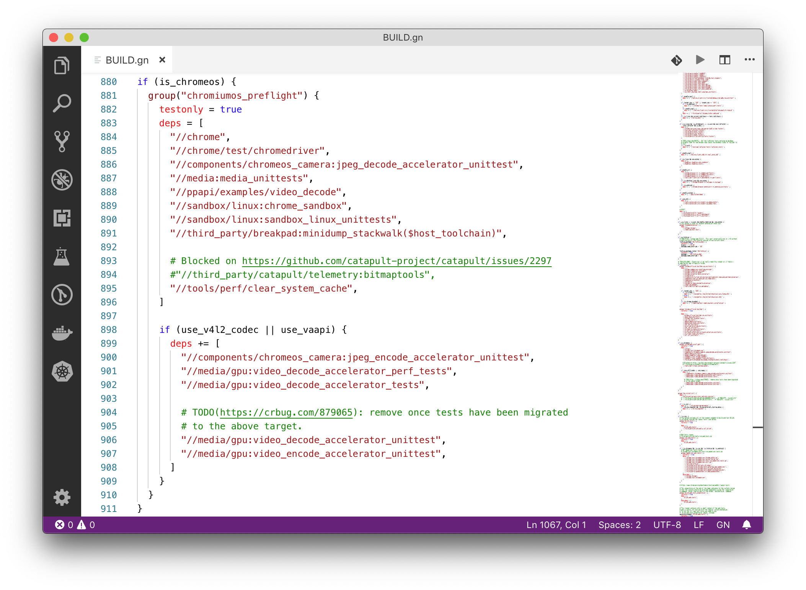

# GN Syntax Highlighting for Visual Studio Code

> ⚠️ **Status: Deprecated**
>
> This extension was originally created simply to package the GN syntax
> highlighting rules shipping with the Chromium source code so they could be used
> in VS Code. I was the first to publish it to the Marketplace, which led to its
> popularity, but the core syntax logic was not my original work.
>
> I have archived this repository because it is no longer maintained. Users should
> migrate to the newer, actively maintained extension now officially recommended
> by the Chromium team: [GN Language
> Server](https://chromium.googlesource.com/chromium/src/+/HEAD/docs/vscode.md#recommended-extensions).

[GitHub](https://github.com/npclaudiu/vscode-gn)
&middot;
[Marketplace](https://marketplace.visualstudio.com/items?itemName=npclaudiu.vscode-gn)

